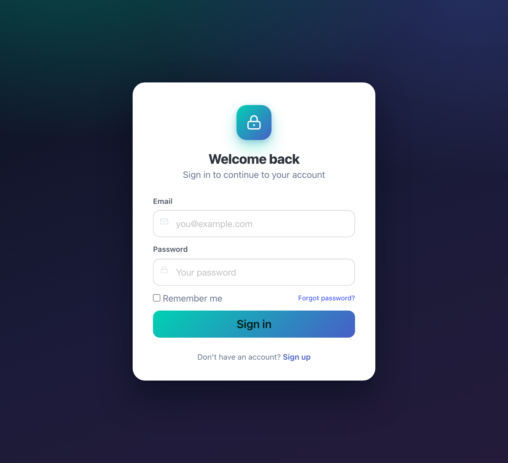

# Login with Bulma

A reactive login form built with [WebSharper.UI](https://websharper.com/docs/ui)
and styled with [Bulma](https://bulma.io/). It shows how a small amount of F#
drives a real, validating form: `Var`s track the inputs and reactive attributes
add and remove CSS classes as the user types.

[](https://websharper-samples.github.io/LoginWithBulma)

**[Try it live](https://websharper-samples.github.io/LoginWithBulma)**

## How it works

`src/wwwroot/index.html` is the **whole page template** — the layout, the inline
SVG icons, the Bulma markup and the hole attributes all live there. `Client.fs`
loads that same file with `Template<"wwwroot/index.html", ClientLoad.FromDocument>`
and binds it with `.Bind()`, so there is no separate mount point.

The reactive part is in `src/Client.fs`:

```fsharp
[<SPAEntryPoint>]
let Main () =
    let email = Var.Create ""
    let password = Var.Create ""
    // Warnings appear after the first sign-in attempt, then update live.
    let submitted = Var.Create false

    let emailOk = email.View |> View.Map (isBlank >> not)
    let passwordOk = password.View |> View.Map (isBlank >> not)
    let flagged = View.Map2 (fun sent ok -> sent && not ok)

    IndexTemplate()
        .Email(email)
        .Password(password)
        .AttrEmail([
            Attr.DynamicClassPred "is-danger"  (flagged submitted.View emailOk)
            Attr.DynamicClassPred "is-success" (View.Map2 (fun s ok -> s && ok) submitted.View emailOk)
        ])
        .AttrEmailMessage(Attr.DynamicClassPred "is-visible" (flagged submitted.View emailOk))
        // ... same for the password ...
        .Login(fun e ->
            e.Event.PreventDefault()
            submitted.Value <- true
            if not (isBlank email.Value) && not (isBlank password.Value) then
                JS.Alert (sprintf "Signed in as %s" email.Value))
        .Bind()
```

Key points:

- **`.Bind()` on the whole page** instead of a `Doc.RunById "main"` mount point —
  the served HTML *is* the template, and `.Bind()` fills its holes in place.
- **Reactive class toggling** with `Attr.DynamicClassPred` (a `View<bool>`),
  not `Attr.ClassPred` (a fixed `bool`). The latter is evaluated once at start-up,
  which is why an earlier version of this sample never showed the warnings.
- **`ws-attr` holes accept a list** of attributes, so an input can carry both an
  `is-danger` and an `is-success` state.
- The form uses **`ws-onsubmit`**, so pressing Enter and clicking *Sign in* both
  run the same handler, and `PreventDefault()` keeps the page from reloading.

## Project structure

```
LoginWithBulma/
  src/
    Client.fs                      # template, Vars, reactive validation, [<SPAEntryPoint>]
    Startup.fs                     # ASP.NET Core host (static files from wwwroot)
    LoginWithBulma.fsproj
    wsconfig.json                  # WebSharper SPA output settings
    package.json                   # esbuild
    esbuild.config.mjs             # bundles/minifies the Release output
    Properties/
      launchSettings.json          # dev launch profile (http://localhost:5102)
    wwwroot/
      index.html                   # the whole page template
      css/login.css                # modern styling on top of Bulma
  .github/workflows/
    deploy.yml                     # build Release, publish wwwroot to gh-pages
  docs/
    screenshot.png
  README.md
```

## Running locally

```
dotnet run --project src
```

Then open the URL printed by `dotnet` (<http://localhost:5102>).

> The sample deliberately runs on port **5102**, not the ASP.NET Core default
> 5000. On macOS, AirPlay Receiver listens on port 5000 and answers browser
> requests with `403 Forbidden` (identified by the `Server: AirTunes` header),
> which makes the app look like it is failing to start. If you prefer another
> port, override it with `ASPNETCORE_URLS`, e.g.
> `ASPNETCORE_URLS=http://localhost:5050 dotnet run --project src`.

## Building a release bundle

```
dotnet build src/LoginWithBulma.fsproj -c Release
```

WebSharper compiles the client and [esbuild](https://esbuild.github.io/) bundles
and minifies it into `src/wwwroot/Scripts`.

## Deployment

Every push to `master` triggers `.github/workflows/deploy.yml`: it builds in
Release and, if that succeeds, publishes `src/wwwroot` to the `gh-pages` branch.
